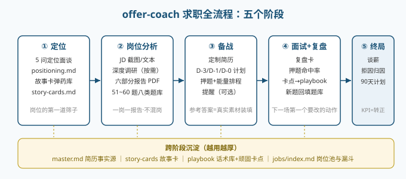
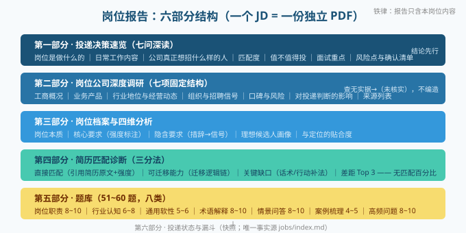
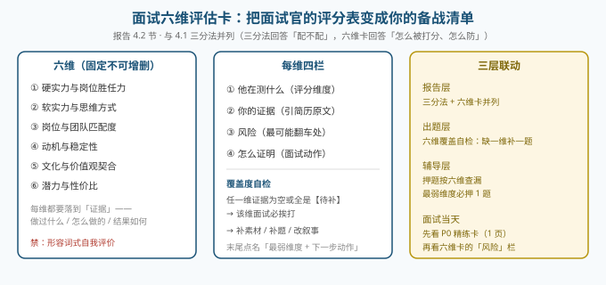
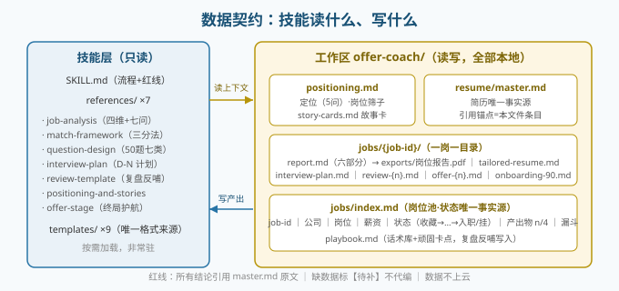

# offer-coach

> 求职全流程教练：**先看懂岗位，再决定怎么投。**
> 岗位深度分析（含公司调研）· 简历匹配诊断 · **面试六维评估卡** · 定制简历 · 50 题八类题库（含压力测试题与红队彩排）· 面试辅导计划 · 复盘与押题校准 · 谈薪 / 拒因归因 / 试用期护航。

[](https://github.com/Asaceoo/offer-coach-puls/releases)
[](LICENSE)

---

## 它解决什么问题

找工作最贵的成本不是投递，是**投错**：花三天准备的岗位，面试时才发现职责是坑、薪资低于底线、公司正在欠税。

offer-coach 把"投递决策"变成一份**可验证的报告**——在投之前回答七个问题：这个岗位到底做什么、公司真正想招什么人、我匹配度如何、值不值得投、面试重点准备什么、有哪些风险要提前确认；并把**面试官的评分表**（六维评估卡）显性化，让你知道每一维会怎么被考、你的证据够不够。

## 五阶段全景



| 阶段 | 触发 | 产出 |
|---|---|---|
| ① 定位 | 首次使用，答 5 问 | 定位档案（岗位第一道筛子）+ 故事卡库（战例卡 + 失败卡） |
| ② 岗位分析 | 发岗位截图/JD | **六部分岗位报告 PDF** + **一页 P0 精练卡** + 定制简历 |
| ③ 备战 | 收到面试通知 | D-3/D-1/D-0 计划、押题（按六维查漏）、能量排程、可选自动提醒 |
| ④ 面试+复盘 | 面完口述 | 复盘卡（押题命中率/卡点/下一场第一个要改的动作）→ 反哺话术库与题库 |
| ⑤ 终局 | offer / 被拒 / 入职 | 谈薪（总包量化）、拒因三层归因、30-60-90 天试用期计划 |

## 报告里有什么



**铁律：一个 JD = 一份独立报告**，绝不把多个岗位混写进同一份；跨岗位统计只存在于岗位池索引与汇总导出。

## 面试六维评估卡（本版本新增的核心）



三分法回答"我配不配这个岗"，六维卡回答"**面试官会怎么给我打分**"。六维固定：硬实力与岗位胜任力 / 软实力与思维方式 / 岗位与团队匹配度 / 动机与稳定性 / 文化与价值观契合 / 潜力与性价比；每维四栏（他在测什么 · 你的证据 · 风险 · 怎么证明），末尾点名**最弱维度**。它不是一段说明，而是三层联动：报告层并列展示 → 出题层按六维查漏补题 → 押题层最弱维度必押一题。

## 四条红线

1. **反虚构**——所有结论引用你的简历原文，缺数据标【待补】不代编
2. **无匹配百分比**——差距用三分法 + 六维卡表达
3. **不给背诵稿**——参考答案与精练卡都是骨架，亲历细节由你核实替换
4. **不做自动投递**——只帮你准备材料，不碰招聘账号

## 数据契约



技能层只读、工作区读写、**全部本地存储不上云**。导出物默认含个人信息（姓名/联系方式/薪酬底线），分享给他人前需删除。

## 安装

```bash
# 方式一：下载 Release zip
# https://github.com/Asaceoo/offer-coach-puls/releases → 解压 offer-coach-vX.Y.Z.zip

# 方式二：源码
git clone https://github.com/Asaceoo/offer-coach-puls.git
cp -r offer-coach-puls/offer-coach ~/.workbuddy/skills/
```

放到 `~/.workbuddy/skills/`（用户级）或工作区 `.workbuddy/skills/`（项目级），重启会话即可。触发词极宽：**找工作、看岗位、发来职位截图或 JD、简历匹配、改简历、面试准备、面试通知、面经、复盘面试、谈薪、offer 比较、试用期**——即使你没点名 offer-coach。

## 打包与发布

```bash
python scripts/package.py           # patch 递增（v1.10.0 → v1.10.1）并产出 dist zip
python scripts/package.py --minor   # minor 递增
python scripts/package.py --no-bump # 不递增重打包
```

脚本自动同步 `docs/用户手册.md` 与 `docs/技术手册.md` 首页版本行。

## 文档

- [用户手册](docs/用户手册.md)——怎么用、每类产出长什么样、FAQ
- [技术手册](docs/技术手册.md)——架构、数据契约、关键设计决策、质量验证记录

## 质量验证

11 轮迭代：鲁班工具闭环（SkillOps / Sentinel / HASP / CASCADE / Distill 全绿）+ 三视角对抗审查（工具实现者 / 审查者 / AI 使用方）+ 独立真机测试（中文/英文 JD、虚构公司零信源场景、多岗位并行、全生命周期链路、成对报告零污染、定位筛边界值）。详见[技术手册](docs/技术手册.md)。

## License

MIT
